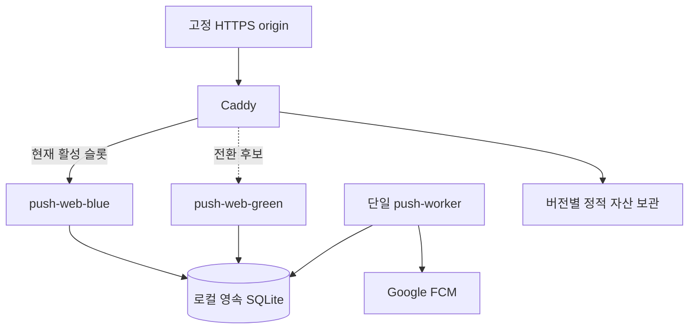

# Web Push 파일럿과 TMS Blue-Green 배포 계획

작성일: 2026-09-21 · 상태: **계획 / 미구현** · 조사 기준: `main@c19010cd19fe7b3d74972d9953622349035883cd`

## 1. 현재 판단

**현재 저장소와 배포 기록에는 Blue-Green 무중단 배포가 구현되어 있지 않다.** Caddy가 단일 Node 프로세스로 연결되고, 릴리스 링크를 바꾼 뒤 systemd 서비스를 재시작한다. 두 슬롯, 후보 readiness 검사, 트래픽 전환, drain, 자동 rollback을 갖춘 배포 경로는 없다.

다만 운영 호스트의 모든 프로세스·컨테이너·실제 적용 설정을 이번에 읽지는 못했다. 따라서 소스와 기존 배포 절차에 대한 판단이며, 별도로 수동 설치한 운영 구성이 없다고 단정하지 않는다.

| 근거 종류 | 확인 내용 | 의미 |
|---|---|---|
| 최신 원격 소스 | 2026-09-21 GitHub `main` SHA `c19010cd19fe7b3d74972d9953622349035883cd` | 조사 기준이 로컬의 오래된 브랜치에 한정되지 않음 |
| [Caddyfile](../../deploy/Caddyfile) | `127.0.0.1:3001` 단일 upstream | Blue/Green 슬롯·전환 설정 없음 |
| [systemd unit](../../deploy/meatbox-gateway.service) | `server.js` 단일 서비스, PORT 3001, 종료 제한 15초 | 컨테이너 두 개를 교대하는 구성 아님 |
| [운영 문서](../operations.md) | release 디렉터리·current 링크 교체 후 `systemctl restart` | 기존 릴리스 보관은 있으나 무중단 전환은 아님 |
| [2026-09-16 배포 기록](../deployment-2026-09-16-integration.md) | 쓰기 API를 503으로 차단한 뒤 재시작·검증 | 당시에는 의도적인 쓰기 중단을 사용 |
| [서버](../../server.js) | `/healthz`·`/readyz` 없음, 종료 시 WebSocket 즉시 terminate | 준비 확인·연결 복구 계약 필요 |
| 현재 HTTP | 2026-09-21 `https://3.36.96.156/login` → HTTP/2 200, Via Caddy | 공개 엔드포인트 응답만 확인. 실행 SHA·프로세스 수 증거 아님 |
| 현재 AWS | `i-03d1f27429c948b7d`, `ap-northeast-2`, running, `t3.micro` 2 vCPU / 1 GiB | 두 슬롯을 추가할 용량은 별도 측정 필요 |
| 런타임 확인 한계 | 해당 EC2의 SSM 목록은 비어 있음. SSH는 신뢰된 host key 부재로 확인 중단 | 실제 서비스·컨테이너·메모리·디스크·설정은 미확인 |

저장소 조사에서는 Dockerfile·Compose·컨테이너 오케스트레이션·CI 배포 workflow가 발견되지 않았다. 과거 문서의 Node/Caddy 버전·운영 배차 수량은 이번 날짜의 현행 값으로 재사용하지 않는다.

## 2. 적용 순서

**독립 알림 파일럿의 웹/API부터 Blue-Green으로 운영하고, TMS 전체는 상태 저장 구조를 정리한 후 적용한다.** [파일럿 구현 계획](web-push-pilot-plan.md)이 선행한다.

| 단계 | 적용 대상 | 완료 의미 |
|---|---|---|
| A | 독립 파일럿 단일 컨테이너 | 실제 기기 알림과 영속 구독 검증 |
| B | 파일럿 웹/API 두 슬롯 + 단일 워커 | 배포·롤백 중 HTTP 제공과 구독·철회 기록 보존 |
| C | 기존 TMS | 공유 세션·상태·트랜잭션·이벤트·클라이언트 복구를 갖춘 후 전환 |

B의 성공을 C의 성공으로 보고하지 않는다. 단일 호스트 Blue-Green은 **앱 교체 중 서비스 연속성**을 목표로 한다. EC2·디스크·Caddy 자체 장애의 고가용성까지 제공하지 않는다.

## 3. 기존 TMS를 바로 두 개 띄울 수 없는 이유

| 현재 제약 | 두 프로세스에서 생기는 문제 | 전체 TMS 전환 전 조건 |
|---|---|---|
| [lib/access.js](../../lib/access.js)의 프로세스 메모리 세션 | 새 슬롯에서 기존 로그인 세션을 모름 | 외부 세션 저장 또는 동일하게 검증·철회 가능한 세션 계약 |
| [lib/source-operations-router.js](../../lib/source-operations-router.js)의 engines·queues Map | 서로 다른 상태와 순서로 요청 처리 | 공통 DB의 트랜잭션·revision/CAS, 명령 멱등성 |
| JSON checkpoint + rename | 한 프로세스 내 저장 원자성만으로 두 프로세스 간 덮어쓰기를 방지하지 못함 | 공용 영속 상태·동시 쓰기 제어. 단순 공유 폴더로 해결하지 않음 |
| 프로세스별 이벤트·WebSocket | 구 슬롯과 신 슬롯 클라이언트가 다른 상태를 볼 수 있음 | 공통 이벤트 전달 또는 authoritative snapshot 재동기화 |
| 종료 시 `ws.terminate()` | 기존 연결 즉시 끊김 | 종료 예고·drain·재연결 후 snapshot 복구, 중복 명령 방지 |
| 버전별 checkpoint 호환 차이 | 이전 코드로 돌아가면 현재 상태를 해석하지 못할 수 있음 | 양 버전 데이터 호환·마이그레이션·별도 데이터 복구 계획 |

확정 배차·진행 중 배송 상태를 다루므로 컨테이너 복제부터 시작하지 않는다. 기존 [통합 점검](../system-integration-audit-2026-09-16.md)과 [상태 보존 배포 기록](../deployment-2026-09-16-integration.md)의 보호 조건을 유지한다.

## 4. 파일럿 목표 구성

같은 이미지의 `web` 모드 두 개와 `worker` 모드 한 개를 사용한다. 슬롯은 loopback의 서로 다른 포트로 노출한다. `3101/3102`는 제안이며 실제 포트 사용 여부를 검사한 뒤 정한다. 기존 TMS의 `3001` upstream과 상태 디렉터리를 변경하지 않는다.

웹 두 개와 워커가 같은 호스트의 로컬 SQLite 볼륨을 쓰는 것은 가능하다. 쓰기 트랜잭션은 짧게 직렬화하고 busy 처리·버전 검증·백업을 적용한다. 다중 호스트 또는 EFS/NFS 공유 파일로 확대하지 않는다. 동시 쓰기량·호스트 분리 요구가 커지면 서버형 DB 전환을 별도 결정한다. [SQLite WAL](https://sqlite.org/wal.html)

워커는 두 슬롯에 복제하지 않는다. 공유 bind mount의 동일 파일에 대한 OS 배타 잠금 획득 전에는 claim을 금지한다. 잠금은 worker 수명 동안 유지한다. DB claim에는 `owner/version/lease_until`을 저장하고 상태 변경은 소유자·버전 CAS로 수행한다. 새 worker는 이전 worker의 미만료 lease를 탈취하지 않는다. lease를 잃은 worker는 새로운 발송을 시작하지 않는다. 외부 FCM timeout 뒤 중복 가능성은 남으며 `정확히 한 번 발송`이라고 보장하지 않는다.

초기 시험값은 FCM 요청 timeout 10초, 종료 drain 30초, claim lease 60초다. 실제 SDK 내부 재시도를 포함해 요청이 유한 시간 안에 끝나도록 설정한다. drain을 초과하면 진행 중 시도를 `unknown`으로 기록하고 종료한다. 강제 종료로 기록하지 못한 `sending`은 lease가 만료된 뒤 새 worker가 `unknown`으로 회수하고 구독·TTL·재시도 정책을 다시 적용한다.

Firebase 프로젝트, 공개 origin, VAPID 키, Service Worker URL·범위, 쿠키 키·검증 방식은 슬롯 전환으로 바뀌지 않는다. 발송 자격증명은 worker에만 read-only로 전달하고, DB·비밀값을 이미지에 포함하지 않는다.

## 5. 호스트 사전 점검과 용량 게이트

실행 전 읽기 전용 점검으로 실제 서비스, container runtime, Caddy 적용 경로·버전, 포트, RAM·swap·CPU·디스크·로그 증가량을 기록한다. 신뢰된 관리 접속 경로를 먼저 확보하며 SSH host key 검증을 우회하지 않는다.

1 GiB 호스트는 기존 TMS와 두 슬롯·워커를 동시에 실행할 여유가 부족할 수 있다. 정상 부하와 배포 중 최고 메모리를 실제 측정한다. **초기 제안 기준**은 두 슬롯 가동 중 호스트 available memory 30% 이상, 새 OOM·swap thrashing 없음, 기존 TMS 응답 악화 없음이다. 수치는 용량 시험에서 근거를 남겨 조정할 수 있으며 하한을 단순히 낮춰 통과시키지 않는다.

디스크에는 활성·직전 이미지, 양 버전 정적 자산, DB·WAL, 백업, 제한된 로그를 동시에 보관할 공간이 있어야 한다. 컨테이너별 메모리·로그 제한을 둔다. 운영 호스트에서 이미지를 빌드하지 않는다.

이 기준을 통과하지 못하면 같은 서버에 억지로 배포하지 않고 별도 시험 호스트 또는 용량 변경을 다음 실행 범위에 포함한다. 이 계획 작성 과정에서는 서버 생성·증설·DNS·방화벽 변경을 수행하지 않았다.

## 6. 이미지·설정·데이터 계약

- 이미지마다 commit SHA와 content digest를 기록한다. `latest`만으로 릴리스·롤백 대상을 식별하지 않는다.
- Compose는 슬롯별 실행 구성에 사용할 수 있지만 `compose up` 자체는 Blue-Green 배포기가 아니다. 전체 stack을 일괄 재생성하거나 `down`하여 활성 서비스를 내리지 않는다. [Compose up](https://docs.docker.com/reference/cli/docker/compose/up/)
- 배포 스크립트는 호스트 배포 잠금, 현재 활성 SHA 확인, 단계 기록을 갖는다. 동시 배포를 거부하고 예상 활성 SHA가 달라졌으면 중단한다.
- DB migration은 양 슬롯 시작 시 각자 실행하지 않고 한 번 실행한다. 릴리스 N과 N-1이 함께 읽고 쓸 수 있는 expand 변경만 무중단 전환에 포함한다.
- 컬럼 삭제·의미 변경 등 contract 단계는 이전 버전 사용·롤백 기간이 끝난 별도 릴리스로 분리한다. 호환 불가능한 변경은 이 배포 경로에서 실패 처리한다.
- 앱 rollback은 트래픽과 실행 버전을 되돌리는 것이다. **DB를 이전 백업으로 되돌리지 않는다.** 새 구독·수신 거부·발송 이력을 삭제하면 중복 발송과 철회 취소가 생길 수 있다.

## 7. 헬스체크와 종료 계약

| 인터페이스 | 확인 내용 | 실패 시 |
|---|---|---|
| `/healthz` | 프로세스 생존, 이벤트 루프의 정상 응답 | 프로세스 재시작 판단 |
| `/readyz` | draining 아님, DB 접근·지원 schema·필수 설정·정적 자산 확인, 비파괴 쓰기 가능 검사 | 후보로 전환 금지 |
| 내부 worker 상태 | heartbeat, 가장 오래된 미처리 작업, 마지막 접수·설정 오류 | 발송 지연·정지 경보 |
| 배포 검증 응답 | 내부 접근에서 build SHA·schema 범위·slot 확인 | 배포 버전 불일치로 중단 |

외부 FCM 일시 장애를 웹 readiness와 직접 연결하여 배송조회까지 내려가지 않게 한다. API는 영속 queue에 저장할 수 있는 동안 접수 상태를 정확히 보여 주고, worker의 발송 지연을 별도로 표시한다. 민감한 설정은 공개 health 응답에 포함하지 않는다.

HTTP 종료는 새 요청 수락 중지 → 진행 중 요청 완료 → 연결 종료 순서다. 초기 shutdown grace 제안은 30초이며 실제 최대 요청·트랜잭션 시간보다 길게 설정한다. request timeout과 DB busy 제한도 이보다 짧게 맞춘다. 이미 성공 응답한 작업은 DB에서 복구되어야 한다. [Node HTTP 종료 API](https://nodejs.org/api/http.html)

파일럿에는 WebSocket이 필요 없다. 기존 TMS로 확대할 때에는 별도 계약이 필요하다. Caddy는 설정 unload 시 WebSocket을 기본적으로 닫을 수 있어 `stream_close_delay` 등과 클라이언트 재연결을 검증해야 한다. 설정 reload 성공을 모든 WebSocket의 무단절로 해석하지 않는다. [Caddy reverse_proxy](https://caddyserver.com/docs/caddyfile/directives/reverse_proxy)

## 8. 정적 자산과 Service Worker

트래픽을 Green으로 옮긴 직후에도 Blue HTML을 가진 브라우저가 이전 JS를 요청한다. 해시 자산은 Caddy가 제공하는 버전별 read-only 디렉터리에 보관하여 두 슬롯에서 모두 접근 가능하게 한다. 새 릴리스 전에 자산을 먼저 게시하고, 최소 활성·직전 릴리스 및 롤백 기간의 파일을 유지한다.

초기 파일럿 세션 상한 24시간과 롤백 보관 기간 중 더 긴 기간을 자산 보관 하한으로 삼는다. 오래된 오프라인 탭이 이 범위를 넘어서 돌아오는 경우 명시적으로 새로고침 안내를 제공한다. 구 JS와 새 API의 호환 범위도 버전 시험에 포함한다.

HTML·고정 SW URL은 재검증하고, 개인정보 API를 cache하지 않는다. 매 배포 `skipWaiting()`으로 모든 열린 탭을 강제 교체하는 정책은 채택하지 않는다. SW 업데이트 대기·새 탭·이전 탭을 시험한다. [Service Worker 생명주기](https://web.dev/learn/pwa/service-workers/)

## 9. 정상 배포 절차

아래 절차는 새 배포 도구의 구현 계약이며 현재 실행 가능한 스크립트가 아니다.

1. **잠금·기록:** 배포 잠금을 획득하고 활성 slot/SHA, 이미지 digest, schema, 설정 checksum, worker 버전을 읽는다.
2. **용량·백업:** 두 슬롯 동시 실행 용량과 디스크를 확인한다. SQLite의 일관된 백업을 만들고 복구 가능한 위치·해시를 기록한다.
3. **준비:** 후보 이미지·버전별 자산을 받는다. secret·volume·origin 설정을 검증한다. 필요한 호환 migration을 단 한 번 실행한다.
4. **후보 시작:** 비활성 web 슬롯만 기동한다. 활성 web과 worker는 그대로 둔다.
5. **후보 검증:** readiness 연속 5회 성공, 내부 SHA 확인, 배포 전용 synthetic 세션으로 조회·구독 저장·철회 smoke를 수행한다. 별도 `deployment_probe` 영역과 서버가 부여한 `deliverable=false`를 사용한다. 이 영역은 enqueue와 worker claim에서 모두 제외하며 outbox 생성·real FCM 호출은 0건이어야 한다. 고정 멱등 키와 TTL 정리로 중간 실패 후 데이터가 남아도 발송되지 않게 한다.
6. **전환:** 후보 Caddy 설정을 별도 파일에서 검증한 뒤 원자적으로 반영하고 reload한다. 공개 origin으로 Green SHA와 HTTPS를 재확인한다.
7. **관찰:** 초기 제안 5분 동안 HTTP 오류·지연, DB busy·작업 적체·철회 보존을 관찰한다. Blue는 롤백 가능 상태로 유지한다.
8. **워커:** 구 worker가 새 schema와 호환되면 웹 검증 후 별도로 교체한다. 새로운 claim 중지 → in-flight 처리 종료/불명 상태 기록 → 단일 잠금 인계 → 새 worker 순서다.
9. **정리:** 관찰 통과 후 Blue의 진행 중 HTTP를 drain하고 중지한다. 이미지·자산·설정은 롤백 기간 동안 유지한다. 배포 결과와 모든 증거를 기록하고 잠금을 해제한다.

Caddy 설정은 validate 후 reload하며 프로세스를 stop/start하지 않는다. reload 실패 시 이전 설정을 유지하는 동작을 별도 시험한다. [Caddy 설정 변경](https://caddyserver.com/docs/getting-started), [Caddy 명령](https://caddyserver.com/docs/command-line)

worker 교체 중의 짧은 queue 대기는 웹 조회 중단과 구분한다. 대기 중 TTL이 지난 알림은 보내지 않는다. 이전 worker가 종료되어 OS 잠금이 해제된 뒤에만 새 worker가 잠금을 획득하고 claim할 수 있다. 그때에도 이전 미만료 lease는 기다린다. 외부 접수 여부 불명 상태는 파일럿 재시도 정책을 따르며 철회된 구독에는 재시도하지 않는다.

## 10. 실패와 롤백

| 실패 시점·원인 | 대응 |
|---|---|
| 후보 시작·ready 실패 | 후보만 중지. 기존 활성 슬롯 유지. 원인과 로그 기록 |
| Caddy 설정 검증 실패 | live 설정을 변경하지 않음 |
| reload 실패·공개 SHA 불일치 | 실제 활성 설정·엔드포인트 확인 후 이전 유효 설정으로 복귀. 성공으로 기록하지 않음 |
| Green 오류 증가 | Blue의 readiness·schema 호환 확인 → Caddy를 Blue로 전환 → 공개 검증 → Green drain |
| worker 오류 | 새 claim 중지, 원인 분류. 호환되는 직전 worker로 교체. 발송 기록·queue는 유지 |
| FCM 일시 장애 | 웹 유지, 만료 이내 제한 재시도, 오래된 ETA 알림 폐기 |
| DB 쓰기 실패·디스크 부족 | 성공 응답 금지. queue 적재·발송 상태를 실제 실패로 기록. 후보 전환 중단 |
| DB 비호환 변경 | 자동 rollback 범위 밖. 전환 전에 차단하고 별도 migration/유지보수 계획 작성 |
| 호스트 장애 | 단일 호스트 BG로 복구 보장 안 됨. 백업·호스트 복구는 별도 절차 |

롤백에서도 배포 잠금을 사용한다. 이전 버전이 정지됐으면 먼저 기동하여 ready를 확인한다. 데이터는 현재 값을 유지한다. DB 백업 복구는 데이터 손실·철회 부활·외부 발송 재시도 위험을 별도로 평가하는 복구 절차이며 일반 코드 rollback에 섞지 않는다.

## 11. 검증 시나리오와 증거

초기 시험 부하는 10 requests/s, Blue→Green→Blue 왕복 3회로 제안한다. 실제 예상 부하가 더 크면 그 수준으로 올린다. 의도한 401/403 검증과 서버 오류를 구분하고, 시험 시간·부하·기기·버전을 기록한다. 제한된 시험의 성공을 무조건적인 무중단 SLA로 표현하지 않는다.

| ID | 시험 | 합격 조건 |
|---|---|---|
| BG-01 | 지속 조회 중 배포·rollback | 시험 구간 정상 요청의 배포 원인 5xx·connection reset 0건 |
| BG-02 | 양 슬롯 동시 구독 저장·중복 요청 | 성공 응답한 모든 구독 영속, 유일 키 유지, 실패를 성공으로 표시하지 않음 |
| BG-03 | 전환·claim 직전/직후 철회·완료 | 전환/rollback 뒤 철회 유지, 철회/완료 commit 이후 과거 작업의 새 claim·재시도 0건. 이미 sending인 시도는 구분 기록 |
| BG-04 | claim 전·FCM 호출 전·응답 전 worker 강제 종료 | OS 잠금 전 claim 없음, 미만료 lease 탈취 없음, 만료 후 unknown 회수·정책 재검사. 중복 가능성을 숨기지 않음 |
| BG-05 | 후보 DB·schema·설정 오류 및 smoke 중단 | ready 실패 시 live slot 유지. 남은 deployment_probe에서 outbox·real FCM 호출 0건 |
| BG-06 | 잘못된 Caddy 설정 | validate/reload 실패 후 기존 HTTPS 요청 계속 처리 |
| BG-07 | 구 HTML·SW + 새 API | 이전 자산 404 없음, 권한·구독 유지, 전경/배경 중복 알림 없음 |
| BG-08 | 전체 컨테이너 재시작 | 초대 소비·세션·구독·철회·queue 유지 |
| BG-09 | 배포 동시 실행·중간 중단 | 두 번째 배포 거부, 실제 Caddy/컨테이너 상태로 안전하게 재개 가능 |
| BG-10 | 백업 복원 | 별도 볼륨에서 DB 무결성·구독/철회/queue 복원 확인, real sender 비활성 |
| BG-11 | 용량 시험 | 메모리·디스크 기준 통과, OOM 없음, 기존 TMS 응답 악화 없음 |
| BG-12 | 실기기 회귀 | 두 OS의 지원 경로에서 배포 전후 등록·표시·클릭 확인. FCM 접수와 별도 증거 |

단위시험·mock 검증, 컨테이너 통합시험, 공개 HTTPS 검증, 실기기 알림 확인을 별도 결과로 보고한다. 배포 이력에는 전/후 SHA·digest·slot·schema·Caddy 설정 checksum·시작/전환/종료 시각·rollback 결과를 남긴다. 구독 식별자 원문이나 서비스 계정 키는 기록하지 않는다.

## 12. 구현 작업 묶음

| 묶음 | 제안 파일·책임 | 완료 조건 |
|---|---|---|
| BG-A 컨테이너 | `services/push-lab/Dockerfile`, web/worker 실행 모드 | 이미지에 secret 없음, 외부 volume 영속, 비특권 사용자 실행 |
| BG-B 단일 호스트 구성 | `deploy/push-lab/compose.yaml`, Caddy fragment, 설정 예제 | 양 슬롯·worker 분리, 기존 TMS 경로 보존 |
| BG-C 배포 도구 | `scripts/push-lab/deploy.*`, `rollback.*`, 상태 기록 | 잠금·후보 검증·전환·drain·실패 복구 자동화 |
| BG-D 상태 호환 | migrations, 세션·outbox·worker lease | N/N-1 동시 동작, 철회·queue·성공 응답 보존 |
| BG-E 검증 | integration/deployment 시험, 기기 체크 기록 | BG-01~12 근거 확보 |
| BG-F 운영 인계 | 실행/장애/복구 runbook | 실제 명령·환경·책임자·보관 정책 기록 |

CI가 없는 현 상태에서는 구현 시 빌드·검증 workflow를 별도로 추가한다. 최초 자동화는 이미지 빌드와 시험까지만 기본 수행하고, 검증된 환경에서 배포 경로를 연결한다. 기존 `deploy/meatbox-gateway.service`를 파일럿 설정으로 대체하지 않는다.

## 13. 전체 TMS 적용의 별도 선행 계획

파일럿 B 완료 후 다음 순서로 C를 검토한다. 이 문서는 지금 TMS 전체를 고치거나 DB 제품을 확정하는 요청으로 확장하지 않는다.

1. **상태와 쓰기 목록 확정:** 로그인 세션, 계정, 날짜별 배차·확정 상태, 배송 진행·완료, 이벤트, 파일 저장의 소유자·읽기/쓰기 경로를 정리한다.
2. **공용 상태 계약:** 프로세스 Map·JSON 쓰기를 authoritative DB 트랜잭션과 revision/CAS로 이전하는 설계를 작성한다. 외부 세션과 서버 간 이벤트 전달은 실제 요구량에 맞춰 선택한다.
3. **데이터 이전·보존:** 현재 운영 데이터의 최신 백업·checksum·건수·상태를 기준으로 dry run, 비교, 복구 시험을 한다. 과거 배포 문서의 수량을 현재 정답으로 고정하지 않는다.
4. **혼합 버전 시험:** Blue/Green 동시 명령, 중복 요청, 구 세션, 구 WebSocket 클라이언트 재연결·snapshot 복구, confirmed 배차 보존을 검증한다.
5. **용량·배포 전환:** 실제 TMS 부하로 두 슬롯 자원을 산정하고 BG 절차를 적용한다. DB migration과 실운영 전환은 별도 검증·운영 변경으로 수행한다.

보존 기준은 계산된 배차와 확정 배차의 구분, 기존 고객/배송원에게 보이는 상태, 성공 응답한 명령의 지속성이다. 원본·영속 파일을 다른 프로세스가 동시에 갱신하게 하는 것만으로 이 조건을 충족했다고 판단하지 않는다.

## 14. 다음 실행의 시작 조건

파일럿 실기기 수신·영속성 검증 완료, SDK/API 조합 고정, 신뢰된 관리 접속, Docker/Caddy 실제 상태 확인, 호스트 용량 통과, 고정 origin·자격증명·복구 위치 확보가 필요하다. 이 조건을 점검한 구현 단계에서 실제 경로·포트·timeout을 확정한다.

공식 문서는 2026-09-21에 확인했다. 이번 산출물은 구현 계획이며 운영 서버에 두 슬롯이나 무중단 배포가 새로 설치됐다는 증거가 아니다.
