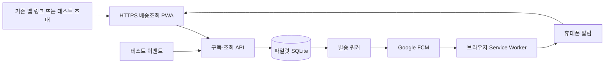

# 고객 배송조회 Web Push 파일럿 구현 계획

작성일: 2026-09-21 · 갱신일: 2026-09-22 · 상태: **P1 로컬 mock 구현 / P2 미실행** · 기준: `a9f576d8e3279c6a579bca5df53e2e2eee0caaea`

이 문서는 기존 회사 앱의 PUSH를 연동하지 않고, 우리가 제공하는 배송조회 웹 화면에서 고객이 직접 신청한 배송 알림을 보내는 실험 계획과 단계별 완료 경계를 기록한다. P1 구현은 `services/push-lab/`의 PWA·API·SQLite outbox·mock/real sender 경계와 `deploy/push-lab/`의 로컬 컨테이너 산출물까지 진행했다. Firebase 설정·자격증명 발급·공개 서버 배포·실제 알림 발송·실기기 수신은 수행하지 않았다.

P1 로컬 검증과 P2 입력은 [검증 문서](../push-lab-local-and-device-verification.md)에 기록한다. 로컬 mock, 컨테이너 readiness, 공개 HTTPS, FCM 접수, 실제 기기 표시·클릭은 서로 다른 증거다.

2026-09-23 추가 승인된 **별도 TEST 관제 화면**의 구현 계약은 [Push Lab 관제 계획](push-lab-control-console-plan.md)에 둔다. 기존 고객 세션·구독과 outbox 경계를 유지하며, 관제의 관리자 인증은 고객 초대와 독립된다. 이 추가 계획은 로컬 mock 구현 범위이며 실제 sender, 서버, DNS 또는 운영 배포 승인으로 해석하지 않는다.

## 1. 결정과 완료 조건

**임시 배송조회 페이지 + 작은 구독 API + 영속 저장소 + 알림 발송 워커를 하나의 이미지로 만든다.** FCM 자체를 컨테이너에 설치하는 방식이 아니다. 우리 컨테이너가 Google의 FCM 서비스에 발송을 요청한다. [FCM 구조](https://firebase.google.com/docs/cloud-messaging/fcm-architecture)

첫 완료 조건은 허용된 테스트 사용자가 자신의 배송 페이지에서 알림을 신청하고, 페이지를 닫은 뒤 휴대폰에서 테스트 알림을 받아 다시 해당 배송을 조회하는 것이다. 기존 TMS 백엔드 안정화나 기존 앱 개발사의 PUSH API 제공을 기다리지 않는다.

| 결정 | 이번 계획 |
|---|---|
| 사용자 진입 | 기존 앱의 배송조회 링크 또는 테스트 초대 링크 → 우리 HTTPS 배송조회 페이지 |
| 독립 알림 | 지원 브라우저/PWA에서 사용자가 신청하고 브라우저 알림 권한을 허용 |
| 서버 범위 | 별도 `push-lab` 서비스. 기존 TMS 프로세스·배차 상태와 분리 |
| 이벤트 | 허용된 테스트 주문의 수동 상태 변경과 30초 예약 발송부터 시작 |
| 저장소 | 단일 호스트의 로컬 영속 볼륨 SQLite. 메모리나 컨테이너 내부 임시 파일에 저장하지 않음 |
| 화면 갱신 | 화면이 보일 때 짧은 polling. 파일럿에 WebSocket을 추가하지 않음 |
| 알림 증명 | 서버 접수, FCM 접수, 기기 표시 확인, 클릭 후 조회를 각각 기록 |
| 다음 단계 | 파일럿 검증 → [파일럿 Blue-Green](blue-green-deployment-plan.md) → 실제 배송 이벤트 연동 |

## 2. 현재 저장소에서 확인한 사실

- [package.json](../../package.json)은 Express·ws 기반이며 Firebase SDK가 없다. [고객 화면](../../apps/combined/mobile-customer.html)의 알림은 페이지 내부 UI이고 실제 Web Push 수신 구현이 아니다.
- [server.js](../../server.js)의 기존 로그인 게이트와 CSP를 그대로 사용하면 독립 고객 구독 및 Firebase 통신 요구와 맞지 않는다. 기존 전체 사이트의 CSP를 느슨하게 만드는 대신 파일럿 origin에 필요한 정책을 따로 둔다.
- [통합 점검](../system-integration-audit-2026-09-16.md)에 적힌 고객·주문별 실권한, 실제 이벤트, 증빙 저장의 미구현 범위를 이 파일럿에서 이미 완성된 것으로 취급하지 않는다.
- 현재 EC2는 2026-09-21 읽기 전용 AWS 조회 기준 `t3.micro`, 2 vCPU, 메모리 1 GiB다. 실제 여유 메모리·디스크·Docker 설치 상태는 확인하지 못했다. 같은 서버에 추가할지는 용량 측정 후 판단한다.

## 3. 고객 흐름과 지원 범위

고객은 `이번 배송 알림 받기`를 직접 누른다. 기능 지원 확인 → 브라우저 권한 요청 → 브라우저 등록 → 서버의 주문별 구독 저장까지 성공해야 `알림 받는 중`으로 표시한다. 체크박스 선택만으로 OS 알림 권한이 생기지는 않는다. 이미 거부한 권한은 재요청을 반복하지 않고 설정 안내를 제공한다. [Firebase Web 설정](https://firebase.google.com/docs/cloud-messaging/web/get-started)

| 환경 | 제공 방식과 검증 기준 |
|---|---|
| Android 지원 브라우저 | HTTPS 페이지에서 권한 허용 후 등록. Chrome 실기기를 첫 검증 대상으로 사용 |
| iPhone/iPad | iOS/iPadOS 16.4 이상 홈 화면 Web App에서 검증. 일반 Safari 탭에서는 홈 화면 추가 안내 |
| 일반 앱 WebView | 독립 Web Push 지원을 전제하지 않음. 미지원이면 외부 지원 브라우저로 열기 안내 |
| 기타 앱 내 브라우저 | WebView와 Custom Tabs를 같은 것으로 취급하지 않음. 실제 API·SDK 지원 여부와 기기 동작으로 판단 |
| 미지원·권한 거부 | 배송조회는 계속 제공하고, 알림 상태를 정확히 표시 |

iOS의 홈 화면 추가와 사용자 동작에 의한 권한 요청은 플랫폼 조건이다. 현재 앱의 버튼만 누르면 모든 iPhone에 자동 알림이 온다고 약속할 수 없다. [Apple Web Push](https://developer.apple.com/documentation/usernotifications/sending-web-push-notifications-in-web-apps-and-browsers), [WebKit iOS 16.4](https://webkit.org/blog/13878/web-push-for-web-apps-on-ios-and-ipados/), [MDN 브라우저 지원 원본](https://github.com/mdn/browser-compat-data/blob/main/api/PushManager.json)

권한, 브라우저 등록, 주문 구독은 서로 다른 상태다. 화면에는 `미지원 / 신청 전 / 권한 거부 / 등록 중 / 알림 받는 중 / 등록 실패 / 해제 / 만료`를 구분한다. 브라우저 권한 철회는 페이지 재방문 시 재확인하고, 서버가 즉시 철회를 알 수 있다고 가정하지 않는다.

알림 발신 주체는 우리 배송조회 사이트/PWA로 표시된다. 기존 회사 앱의 시스템 알림함에 들어가는 네이티브 PUSH를 대신하는 것은 아니다. 기존 앱에는 링크를 여는 범위만 요청할 수 있고, 파일럿은 초대 링크로 독립 실행할 수 있다.

## 4. 화면과 테스트 시나리오

현재 미트박스 모바일 디자인을 따른다. 실제 배송으로 오해하지 않도록 테스트 페이지와 알림에 `테스트`를 표시한다. UI 구현 전에는 기존 디자인에 맞춘 화면안을 먼저 검토한다.

| 배송 단계 | 화면 | 파일럿 알림 |
|---|---|---|
| 결제완료 | 주문 접수 안내, 지도·차량 없음 | 기본 미발송 |
| 배송접수 | 배송 신청 상태, 지도·차량 없음 | 기본 미발송 |
| 물류입고 | 상품 준비 상태, 지도·차량 없음 | 기본 미발송 |
| 배송대기 | 지도 표시 시작, 차량 이동·ETA 계산 시작으로 표현하지 않음 | 기본 미발송 |
| 배송 중 | 테스트 차량 위치·경로와 도착예정시간 | 배송 출발 테스트 알림 |
| 근처 도착 | 가까워진 차량과 갱신된 도착예정시간 | 근처 도착 테스트 알림 |
| 배송 완료 | 완료 상태와 완료 시각 | 배송 완료 테스트 알림 |

지도·차량·ETA는 승인된 테스트 fixture에 한정한다. 실제 GPS나 알고리즘 산출 결과라고 표현하지 않는다. 기준 시각보다 이전인 ETA를 노출하지 않고 `예정` 표현을 유지한다. 단순 알림 검증에 실제 경로 계산기·사진 저장소·배송원 앱 개발은 필요하지 않다.

가장 작은 실기기 시험은 다음 순서다.

1. 운영자가 허용한 테스트 초대 링크를 기기에서 연다.
2. `이번 배송 알림 받기`를 누르고 권한을 허용한다.
3. `30초 뒤 테스트 알림`을 예약하고 예약 접수 상태를 확인한다.
4. 페이지를 닫거나 화면을 잠근다.
5. 알림 표시를 직접 확인하고 알림을 눌러 해당 배송으로 돌아온다.

## 5. 서비스 구성

이미지는 하나로 관리하되 실행 모드를 `web`, `worker`, 초기 개발용 `all`로 분리할 수 있게 구성한다. 첫 단일 컨테이너 시험은 `all`로 가능하고, Blue-Green 전에는 두 웹 슬롯과 한 워커로 분리한다. FCM 자격증명은 워커에만 필요하다. 구독 API는 인증과 DB만 사용한다.

고정 HTTPS origin을 사용한다. 현재 IP의 HTTPS 접속 자체가 불가능한 것은 아니지만 주소·인증서·Service Worker 범위가 바뀌면 기존 구독의 연속성을 잃을 수 있어, 실험부터 유지할 호스트명을 정하는 편이 낫다. 도메인과 DNS는 아직 선택·변경하지 않았다.

제안 경로는 `/push-lab/` 및 `/push-lab/api/`이며 Service Worker도 `/push-lab/` 범위로 제한한다. SDK에 명시적 Service Worker registration을 전달하여 루트 범위 기본 동작에 의존하지 않는다. 배포 슬롯 이름이나 버전은 공개 origin과 SW URL에 넣지 않는다.

## 6. SDK·FCM 계약을 먼저 고정

2026-09-21 확인한 Firebase Web 가이드는 `register()`·`onRegistered()`와 Firebase Installation ID(FID)를 권장하고, `getToken()`을 deprecated로 표시한다. 반면 오래된 예제와 일부 발송 설명에는 registration token이 남아 있다. 두 방식을 섞어 저장하거나 FID를 token 필드에 넣지 않는다. [Web 시작 가이드](https://firebase.google.com/docs/cloud-messaging/web/get-started), [HTTP v1 발송 가이드](https://firebase.google.com/docs/cloud-messaging/send/v1-api)

조사에서 릴리스 소스로 확인한 조합은 **`firebase@12.19.0`의 `register()` / `onRegistered()` → `firebase-admin@14.4.0`의 `send({ fid, ... })`**다. Admin SDK는 `fid` 대상을 HTTP v1에 전달한다. `installationId`라는 발송 필드나 FID를 넣은 `token` 필드를 사용하지 않는다. [JS SDK register 원본](https://github.com/firebase/firebase-js-sdk/blob/9045b759b70e9d19b8cf007d69d988893d845a1e/packages/messaging/src/api/register.ts), [Admin SDK FID 타입 원본](https://github.com/firebase/firebase-admin-node/blob/7cf116b4c4e73ff5b58814f343738535153fdf08/src/messaging/messaging-api.ts), [Admin SDK 발송 가이드](https://firebase.google.com/docs/cloud-messaging/send/admin-sdk)

이 조합은 `services/push-lab/package-lock.json`에 고정했고 로컬 mock 계약 시험을 통과했다. 다만 실제 Firebase project와 브라우저 FID를 이용한 발송 접수는 P2의 작은 실발송 시험으로 별도 검증한다. 다음 근거를 lockfile과 시험 기록에 남긴다.

- 선택한 패키지의 실제 공개 export와 브라우저 등록 식별자 종류.
- 해당 식별자를 받는 서버 발송 API의 정확한 필드·인증 방식 및 지원 버전.
- Android·iOS 대상의 등록 → 발송 접수 → 실제 표시 결과.
- 선택한 방식 하나만 쓰는 구독 갱신·폐기 동작. 전환이 필요하면 명시적 마이그레이션으로 다룬다.

FCM은 서버가 임의로 만든 문자열로 기기를 지정하는 서비스가 아니다. 실제 브라우저 등록으로 얻은 식별자를 보관하고, 임시성은 **우리 주문 구독의 만료 시각**으로 관리한다. 공개 Firebase 설정·VAPID 공개키와 서버 발송 자격증명을 구분한다. [등록 관리](https://firebase.google.com/docs/cloud-messaging/manage-tokens), [Admin SDK 설정](https://firebase.google.com/docs/admin/setup)

## 7. 최소 API와 권한 계약

아래 경로·테이블·파일 경계는 P1 로컬 구현에 반영되었다. 실제 고객 식별·주문 이벤트·운영 발송 API와의 연결은 아직 없다.

| 제안 API | 역할·조건 |
|---|---|
| `POST /push-lab/api/session/exchange` | 허용된 테스트 초대의 불투명한 단기 코드를 1회 교환, 해당 주문 권한을 가진 세션 발급 |
| `GET /push-lab/api/deliveries/:deliveryId` | 세션의 허용 주문 집합에 포함된 테스트 배송만 조회. ID는 선택 값이며 권한이 아님 |
| `PUT /push-lab/api/registration` | 현재 브라우저의 검증된 종류의 등록 식별자 저장·갱신 |
| `PUT /push-lab/api/deliveries/:deliveryId/subscription` | 허용된 주문과 기기의 명시적 알림 신청 저장. 재요청은 같은 결과 |
| `DELETE /push-lab/api/deliveries/:deliveryId/subscription` | 허용된 주문 구독 철회 및 대기 알림 취소. 진행 중 발송의 경계는 9절 적용 |
| `POST /push-lab/api/deliveries/:deliveryId/self-test` | 자신의 구독에만 30초 테스트 예약. 세션별 제한 및 중복 키 적용 |
| 비공개 CLI `emit-test-event` | 허용된 테스트 주문 상태 변경·알림 생성. 일반 고객에게 전체 발송 API를 노출하지 않음 |

테스트 초대는 운영자 CLI로 허용한 테스트 사용자·주문에만 발급한다. 미사용 코드의 CAS 소비와 세션·주문 권한 생성은 한 트랜잭션이다. 동일 코드의 서로 다른 교환 키는 두 번째부터 거부한다. 응답 유실에 대비해 같은 코드와 동일 교환 키는 최초 교환 후 2분 이내에 같은 유효 세션 쿠키를 재발급할 수 있게 한다. 복구용 응답은 짧게 암호화 보관하고 이후 삭제하며, 초대·교환 키 원문은 로그에 남기지 않는다. 기한이 지나 복구할 수 없으면 새 초대를 발급한다.

쿠키는 Secure·HttpOnly·SameSite=Lax, `Path=/push-lab/`, 주문 권한의 잔여 유효 시간에 맞는 만료를 사용한다. 세션 해시는 DB에 보관하고, 복구 암호화 키와 검증 키는 두 슬롯이 공유한다. 키 교체는 이전 세션 만료까지 구 키를 검증할 수 있어야 한다. 동일 테스트 사용자로 확인된 추가 초대는 기존 세션의 허용 주문 집합에 권한을 추가하며 첫 주문 권한을 덮어쓰지 않는다. 다른 사용자 초대로 기존 세션의 권한을 합치지 않는다.

최초 링크는 fragment 등의 방식으로 서버 접근 로그에 남는 것을 피하고 교환용 값을 확보한 뒤 주소에서 제거한다. `Referrer-Policy: no-referrer`, 요청 본문 로그 제외, Origin/CSRF 검증을 적용한다. 원시 주문번호나 FCM 식별자만 아는 것으로 조회·해제·발송 권한을 얻지 못하게 한다.

알림 클릭 URL에는 불투명한 배송 선택 ID만 넣고 민감정보·초대 코드·발송 자격증명은 포함하지 않는다. 같은 브라우저의 유효한 세션에서 해당 주문의 권한을 다시 확인한다. 두 주문의 알림을 번갈아 눌러도 각각 원래 주문을 열며, 세션이 만료됐으면 재인증 안내만 보여 준다. 새 기기에 조회 권한을 조용히 확장하지 않는다. 처음에는 테스트 초대 방식으로 충분하며, 실서비스 고객 식별 연동은 별도 전환 조건이다.

## 8. 영속 데이터와 중복 방지

| 데이터 | 최소 내용 |
|---|---|
| 테스트 배송 | 내부 ID, 단계, revision, 시나리오 기준 시각, 예정 시각, 만료 시각 |
| 브라우저 설치·등록 | 안정된 내부 설치 ID, 해당 설치의 증명 쿠키, provider·프로젝트, `fcm_fid` 값·버전, 갱신·무효화 상태 |
| 주문별 구독 | 배송 ID + 내부 설치 ID 유일 키, 동의 버전·시각, 만료·철회 시각 |
| 초대·세션·주문 권한 | 해시, 테스트 사용자, 허용 주문 집합, 만료·소비 상태, 짧은 교환 재시도 정보 |
| 이벤트·outbox | event ID, 배송 revision, 구독 ID, 알림 종류, 발송 가능·만료 시각, 상태, 재시도·lease 정보 |
| 발송 시도 | 요청 attempt ID, 시작·종료, FCM 접수 ID 또는 오류 분류, 클릭·조회 참고 이벤트 |

배송 변경과 이벤트·outbox 생성은 한 트랜잭션에서 처리한다. `(event_id, subscription_id, notification_type)` 유일 제약으로 중복 등록을 막는다. 성공 응답은 DB commit 뒤에 반환한다. FCM 네트워크 요청 동안 DB 트랜잭션을 열어 두지 않는다.

`onRegistered()`로 FID가 바뀌면 설치 증명과 유효 세션을 확인한 뒤 해당 설치의 활성 FID를 한 트랜잭션에서 교체한다. 주문 구독은 내부 설치 ID에 연결되어 있으므로 여러 주문이 함께 새 FID를 사용한다. 철회·만료 구독을 재활성화하지 않는다. 대기 작업은 claim 시 최신 FID·버전을 선택하고, 이미 `sending`인 시도는 선택했던 버전을 기록하여 새 FID로 자동 복제 발송하지 않는다. 설치 증명까지 사라진 브라우저는 새 설치로 취급하고 다시 동의를 받으며 임의 설치 ID로 이전 권한을 가져오지 못한다.

SQLite는 이미지와 별도인 로컬 영속 볼륨에 둔다. `WAL`, `synchronous=FULL`, 짧은 트랜잭션, 유한 `busy_timeout`과 제한된 재시도를 사용한다. 같은 호스트의 여러 프로세스는 접근할 수 있지만 쓰기는 한 번에 하나이고, 네트워크 파일시스템·다중 호스트 공유 WAL은 사용하지 않는다. 실제 라이브러리가 WAL-reset 수정이 포함된 **3.51.3 이상 또는 해당 수정의 검증된 백포트**인지 확인한다. [SQLite WAL](https://sqlite.org/wal.html)

백업은 SQLite backup API 등의 일관된 스냅샷 방법으로 만들고 별도 볼륨에서 복구를 시험한다. 실행 중인 `.db` 파일 하나만 복사하는 방식으로 WAL의 미반영 내용을 놓치지 않는다. 백업도 민감정보로 취급한다. [SQLite Backup API](https://sqlite.org/backup.html)

## 9. 알림 수명·재시도·철회

다음 시간은 **파일럿 시험 기본값 제안**이다. 실서비스 운영 정책이나 SLA로 확정한 값이 아니다.

| 항목 | 제안 정책 |
|---|---|
| 테스트 주문·조회 세션 | 생성 후 최대 24시간. 더 이른 주문 만료가 있으면 그 시각 적용 |
| 출발 알림 | 이벤트 후 최대 30분 유효 |
| 근처 도착 알림 | 이벤트 후 최대 5분 유효 |
| 완료 알림 | 이벤트 후 최대 30분 유효. 주문 만료를 넘길 수 없음 |
| 완료 후 구독 | 이전 단계 대기 알림 즉시 취소. 완료 알림만 유효 기간 내 처리하고 종료 |
| 수신 거부 | `queued/retrying` 작업 즉시 취소. 철회 commit 이후 새 claim·재시도 금지. 이미 `sending/unknown`인 시도는 도착 가능 |
| 시험 기록 정리 | 기본 7일 후 로그·만료 세션 정리. 활성 구독이 없는 등록 식별자도 정리 |

worker는 구독 철회·주문 만료·현재 revision·단계를 검사하고 `queued → sending`으로 claim하는 작업을 한 DB 트랜잭션에서 수행한다. 철회·배송 완료 트랜잭션은 이후 claim을 막고 이전 단계의 대기 작업을 취소한다. 먼저 claim된 시도는 실제 FCM 호출·응답 전이라도 이미 진행 중인 발송이다. 그 사이 철회가 성공해도 도착할 수 있으며, UI와 기록에 이 경계를 명시한다. 철회 이후 해당 시도의 새 재시도는 하지 않는다.

FCM에 이미 접수되었거나 진행 중인 알림은 서버가 확실히 회수할 수 없다. 짧은 provider TTL을 함께 적용하고, 클릭한 화면은 최신 상태를 다시 읽는다. TTL은 이벤트 시점의 유효 종료까지 남은 시간으로 계산한다. [FCM 메시지 수명](https://firebase.google.com/docs/cloud-messaging/customize-messages/setting-message-lifespan)

`429`·일시적 서버 오류는 `Retry-After`와 지수 backoff·jitter를 적용해 만료 전까지만 재시도한다. 무효 등록은 비활성화하고, 권한·프로젝트 설정 오류는 일괄 재시도를 멈추고 운영자에게 드러낸다. `INVALID_ARGUMENT`는 payload도 검사하여 잘못된 메시지 때문에 모든 등록을 삭제하지 않는다. 응답을 받기 전 timeout은 발송 여부 불명 상태로 남긴다. [FCM 규모·재시도 지침](https://firebase.google.com/docs/cloud-messaging/scale-fcm), [FCM 오류 코드](https://firebase.google.com/docs/cloud-messaging/error-codes)

중복 enqueue를 막아도 외부 발송 timeout 뒤 재시도까지 정확히 한 번으로 보장할 수는 없다. event ID와 notification tag를 사용해 중복 노출을 줄이되 이를 전달 보장으로 표현하지 않는다. 한 주문 종료 때문에 같은 기기의 다른 주문 구독이나 브라우저 전체 등록을 지우지 않는다.

## 10. Service Worker·자격증명·표시 책임

- JS/CSS는 해시가 있는 자산 URL, HTML·SW는 재검증되는 고정 URL을 사용한다. 이전 탭·이전 SW와 새 API가 함께 존재하는 경우를 시험한다.
- 배송 정보·초대 링크·API 응답을 오프라인 캐시에 저장하지 않는다. 로그와 알림 본문에 고객 상세 주소·전화번호를 넣지 않는다.
- 배경 알림 표시 주체를 하나로 정한다. FCM notification 자동 표시와 SW의 수동 `showNotification`을 동시에 실행해 두 번 표시하지 않는다. 전경에서도 별도 동의 없는 팝업·시스템 알림 중복을 피한다. [FCM Web 수신](https://firebase.google.com/docs/cloud-messaging/web/receive-messages)
- Firebase SDK는 고정 버전으로 번들링하고, CSP에는 실제 선택한 SDK의 등록·발송 흐름에서 필요한 origin만 허용한다. 기존 TMS의 전체 정책을 `*`로 바꾸지 않는다.
- 발송용 서비스 계정은 최소 권한을 부여하고, 이미지·Git·브라우저·로그에 넣지 않는다. 초기에는 보호된 파일을 워커에 read-only mount하는 방법을 사용할 수 있다. 키 보관·교체 담당자를 기록한다.
- mock sender와 real sender는 실행 설정으로 명확히 구분한다. real 모드도 허용된 테스트 구독만 발송한다. FCM은 Local Emulator Suite 지원 목록에 없으므로 mock 통과를 실기기 수신 증명으로 쓰지 않는다. [Firebase Emulator Suite](https://firebase.google.com/docs/emulator-suite)

## 11. 관찰과 합격 기준

FCM message ID는 외부 서비스가 요청을 접수한 증거다. 휴대폰에 보였는지 또는 읽었는지는 별도다. `queued / sending / accepted / unknown / expired / cancelled / failed`를 발송 상태로, `clicked / viewed`를 후속 관찰로 구분한다. SW의 best-effort ACK도 표시·열람 확정으로 표기하지 않는다.

| 시험 | 합격 조건 |
|---|---|
| P-01 지원·권한 | 허용·거부·철회·미지원 각각 정확한 UI, 거부 시 서버 활성 구독 생성 안 됨 |
| P-02 실제 수신 | Android Chrome, iPhone 홈 화면 PWA에서 페이지 닫기·잠금 후 표시를 각각 확인 |
| P-03 클릭·권한 | 알림 클릭 후 자기 주문 최신 상태만 조회, 다른 주문·만료 세션 접근 거부 |
| P-04 중복·다중 주문·FID 교체 | 중복 이벤트는 outbox 1개, FID 변경 후 두 활성 주문이 새 등록 사용, 철회는 유지, 두 알림 클릭 시 각각 올바른 주문 조회 |
| P-05 유효 기간·철회 경합 | claim 직전/직후에 철회·완료를 실행. commit 이후 과거 작업의 새 claim·재시도 0건, 이미 sending인 시도의 도착 가능성을 정확히 기록 |
| P-06 장애 | 429·5xx·timeout·무효 등록·잘못된 자격증명을 분류하고 무한 재시도 안 함 |
| P-07 영속성 | 재시작 후 동의·철회·예약 작업 유지. DB 쓰기 실패 시 성공 응답 안 함 |
| P-08 SW 갱신 | 이전 탭과 새 SW/API 공존, 전경·배경 알림 중복 없음, 이전 자산 누락 없음 |
| P-09 보안·교환 경합 | 임의 주문·설치 접근, CSRF, 무제한 self-test 차단. 동시 초대 교환은 세션 1개, 같은 교환 키의 응답 유실 복구와 다른 키 거부 검증 |
| P-10 표시 정확성 | 모든 실험 알림에 테스트 표시, ETA ≥ 기준 시각, 도착 시각은 예정으로 표현 |

시험 기록에는 기기·OS·브라우저·SDK 버전, 이미지 digest, 시나리오, enqueue/접수 시각, 기기 표시 수동 확인, 클릭 후 화면 결과를 남긴다. 표시 지연은 측정값으로 보고하며 모든 환경의 정시 수신을 보장하지 않는다. 허용된 기기 외 발송 건수는 0이어야 한다.

## 12. 실행 순서와 파일 경계

| 단계 | 작업·산출물 | 다음 단계 조건 |
|---|---|---|
| P0 계약·환경 | 고정 origin, 테스트 Firebase 프로젝트·발송 API 조합, 자격증명 주입 방식, 기기 확보, EC2 용량 측정 | 식별자·발송 API 조합 확인, 격리 실행 위치 결정 |
| P1 로컬 | 페이지·초대 세션·구독 DB·outbox·mock sender·예약 시험 구현 | P-01/04/05/06/07/09/10 자동 검증 |
| P2 실제 수신 | HTTPS 시험 환경에 이미지 배포, allowlist real sender 활성화 | P-02/03/08 실기기 증거, 서버 접수와 기기 표시 구분 |
| P3 운용 | 만료 정리, 백업 복구, 재시작, 오류 기록, rate limit 점검 | 영속성·철회 보존 검증, 비밀값 미포함 확인 |
| P4 배포 | 두 웹 슬롯과 단일 워커 분리, 별도 Blue-Green 계획 실행 | 배포·롤백 중 구독 손실·허용되지 않은 추가 발송 없음 |
| P5 실제 연동 | 신뢰할 수 있는 배송 이벤트·고객 권한 어댑터 추가 | 이벤트 ID·순서·취소·시간 계약과 실제 고객 권한 검증 |

제안 구현 위치는 `services/push-lab/` 안의 `public/`, `server/`, `worker/`, `migrations/`, `test/`, `Dockerfile`이다. 루트 TMS 의존성과 별도 package/lockfile로 관리한다. 배포 설정은 `deploy/push-lab/`에 둔다. 현재 원본 화면·진행 중 캡처 작업·배차 파일은 수정 범위에 넣지 않는다.

P0에서 실제 서버의 메모리·디스크·포트·서비스·컨테이너 상태를 읽고 측정한다. 1 GiB 호스트에 들어간다고 먼저 가정하지 않는다. 이미지는 로컬/CI에서 빌드하고 서버는 pull·실행만 한다. 여유가 부족하면 별도 시험 호스트 또는 용량 변경을 실행 계획에 반영한 뒤 배포한다.

이번 계획으로 정하지 않은 값은 실제 도메인, Firebase 프로젝트·서비스 계정, 기기 목록, 실서비스 동의·보관 정책, 실제 배송 이벤트 소유자다. SDK/API는 위 릴리스 조합을 기준으로 실제 패키지와 기기에서 검증해야 한다. 모두 P0/P2 또는 P5의 입력으로 명시했으며 임의 자격증명·실고객 데이터로 대체하지 않는다.

## 13. 선택하지 않은 구성

- 기존 앱의 FCM 토큰을 가져오거나 회사 앱 PUSH 서버에 의존하는 방식: 독립 실험 목적과 다르다.
- FCM 서버 Docker 이미지·임의 임시 토큰 발급: 이 시스템이 제공하는 기능이 아니다.
- 정적 페이지만으로 발송: 권한·구독 수명·예약·재시도를 책임질 서버와 영속 데이터가 필요하다.
- 초기부터 Kafka·Redis·Kubernetes·다중 호스트: 작은 실기기 실험의 선행 조건이 아니다. 운영 규모·다중 호스트 요구가 생기면 다시 결정한다.
- 모든 환경을 Web Push 하나로 커버한다고 약속: iOS 설치 단계와 미지원 환경이 남는다. SMS·카카오 등의 보완 채널은 별도 제품 결정이다.

공식 문서 확인일은 2026-09-21이다. 문서와 릴리스 API가 다른 부분은 P0 계약 시험으로 해소하고, 구현자는 위 완료 조건을 검증하면서 계획을 갱신한다.
